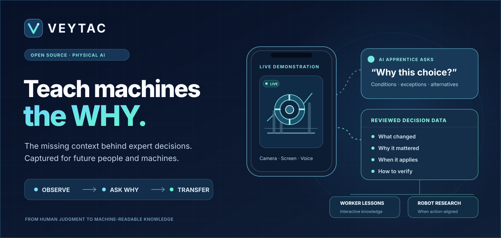

<p align="center">
  
</p>

# VEYTAC

### The knowledge layer between human expertise and machine intelligence.

**A video can show what an expert did. It often cannot explain why they did it, what they noticed, or when another decision would be right.**

VEYTAC is building **industrial apprenticeship infrastructure**: a phone- and screen-first AI apprentice that observes skilled work, asks targeted questions in the expert's language, and turns approved explanations into **evidence-linked skill data** for future workers, AI systems, and robotics research.

Our long-term goal is ambitious: **make practical human expertise preservable, transferable, and useful for the next generation of intelligent machines.** The platform, contributor-controlled dataset exchange, and future industrial sensor integrations are parts of that mission—not the mission itself.

> **Observe the work. Ask why. Preserve the judgment. Test what transfers.**

**Project stage:** experimental, open-development prototype for the Meta Global AI Developer Hackathon — Startup Track / Push the Frontier. See [what is implemented vs. still unverified](#current-prototype--honest-status).

## The missing information in today's demonstrations

When a technician stops an assembly, an engineer rearranges a control diagram, or an operator changes a machine setting, the visible action captures only part of the expertise.

The missing layer is **decision context**:

- **Situation:** What state was the equipment or task in?
- **Signals:** What did the expert see, hear, feel, or read?
- **Judgment:** Why this action rather than an alternative?
- **Boundaries:** When would the decision be wrong?
- **Evidence:** How was the outcome checked?

Ordinary video datasets can preserve movement. VEYTAC is designed to ask for the information the recording does **not** contain while someone knowledgeable is available to explain it.

## How VEYTAC works

| Step | What happens | Output |
| --- | --- | --- |
| **01 — Observe** | Capture an approved camera or screen session with speech and timestamps. | Source-linked observations |
| **02 — Investigate** | Identify a consequential unknown and propose an expert question at an appropriate pause. | Explicit knowledge gap |
| **03 — Ask why** | The expert answers, corrects the interpretation, and explains conditions or exceptions. | Grounded dialogue |
| **04 — Review** | A human reviews the proposed decision record and its evidence. | Versioned, approved knowledge |
| **05 — Package** | Export an observation/decision episode and an interactive learning artifact. | Inspectable skill data + lesson |
| **06 — Test transfer** | Compare passive, fixed, and adaptive acquisition on held-out tasks. | Measured results—not assumed gains |

**Not all stages are validated in a real industrial environment.** The core repo provides prototype implementations and test infrastructure; some device/provider and downstream-learning checks remain open.

## Two audiences, one knowledge foundation

**For people:** expert-linked lessons and decision-point explanations that help the next engineer or worker understand the relevant conditions—not only memorize steps.

**For machines:** provenance-rich observation and expert-context data for task understanding and policy research. **Robot action-policy datasets require actual measured/aligned robot state and actions.** Phone video, inferred hand motion, and expert narration are **not** a substitute for those signals.

As the system grows from **smartphones → screens → industrial cameras and synchronized sensors**, the same knowledge record can carry richer evidence without inventing measurements.

## Current prototype & honest status

This repository already contains code for:

- Browser camera/screen capture, chunk upload, and locally tracked frame observations.
- Meta provider adapters for multimodal interpretation and selective SAM segmentation, plus a voice path and speech fallback.
- Question proposals with human-gated delivery, expert answers, and draft decision records.
- Review, episode assembly, lesson creation, a private recording library, and observation dataset exports.
- Provenance, permissions, cost controls, schema validation, mock-provider tests, and evaluation scaffolding.

**Important boundaries:** mock and automated tests are not evidence that a real expert dialogue works reliably on every phone. Recent [implementation notes](docs/MUSE_CODE_FOLLOWUP_2026-11-05-DATASET.md) still call for device-level checks of spoken conversations, SAM masks, replay timing, and dataset quality. The repository has **not demonstrated robot-policy improvement, production-grade authentication, industrial safety certification, or instant physical simulation from video.**

See [implementation status](docs/IMPLEMENTATION_STATUS.md), [verification criteria](VERIFICATION.md), and [dataset quality checklist](docs/DEMO_DATASET_CHECKLIST.md).

## Architecture

```text
Camera / Screen / Mic        Public, permissioned references
          |                             |
          +--------- timestamped evidence --------+
                                                  |
                                     Meta-powered investigator
                                      (Spark, SAM, voice;
                                       Wonder when justified)
                                                  |
                                      Question → expert answer
                                                  |
                                  Provenance + approval + rights
                                                  |
                                     Reviewed skill episode
                                         /          \
                           Interactive lesson     Data export
                                                 /          \
                                      Human/agent tasks   Robot research*
```

*Robot action learning requires genuinely synchronized state/action data, embodiment information and a separate evaluation gate.*

**Stack:** React/TypeScript browser app, Python/FastAPI service, SQLite/local media, Meta API adapters, and a deterministic review/export/evaluation layer. Large datasets and optional training jobs are **not required** for local mock-mode operation.

## Try the prototype

**Requirements:** Python 3.11+, Node.js, npm; FFmpeg recommended for seekable recording derivatives.

From the repository root (PowerShell):

```powershell
python -m pip install -e '.[dev]'
Copy-Item .env.example .env
python -m veytac.cli doctor
python -m veytac.cli serve --host 127.0.0.1 --port 8000
```

In a second terminal:

```powershell
cd apps/web
npm ci
python ../../scripts/setup_vision_assets.py
npm run dev
```

Open the Vite URL printed in the terminal. **The example configuration starts in mock mode.** For camera/microphone capture on a phone, use a trusted HTTPS origin and follow [HTTPS LAN setup](docs/HOSTING.md). Keep API keys out of frontend code and Git; live model calls need separate permission and a spending cap.

**Tests:**

```powershell
python -m pytest tests/ -q
cd apps/web
npm run build
npm run test:perceive
npm run test:e2e
```

Browser and provider tests have different requirements. See [the demo storyboard](docs/DEMO_SCRIPT.md) for a claim-safe demonstration.

## Research, not just recordings

The question is not **“Can an AI ask why?”** It is **“Does an observation-grounded question uncover usable decision context that improves performance on a new case?”**

The [transfer harness](src/veytac/evals/transfer.py) supports passive / fixed / adaptive comparisons on held-out cases. The [robot data gate](src/veytac/datasets/robot.py) rejects phone-only episodes as robot action-policy data. Training on Muse Glimmer, robot imitation learning and RL are **research directions and separately gated experiments**, not claimed results.

## The larger vision

| Now — accessible capture | Next — evaluated knowledge | Future — infrastructure |
| --- | --- | --- |
| Smartphone, screen, voice, reviewed decision episodes | Multilingual guidance, richer annotations, tested transfer to unfamiliar tasks | Industrial cameras/sensors, robot-aligned datasets, contributor-controlled discovery and licensing |

The longer-term platform will enable experts and organizations to contribute approved knowledge, and future workers and model developers to discover useful datasets. **We are not claiming that the marketplace or a universal robot-training pipeline is already shipped.**

Read [the long-term vision](docs/VISION.md) and [how to contribute](CONTRIBUTING.md).

## Rights, safety, and responsible open development

Capture only what you have permission to record and process. Recording, external inference, training, and publication require **separate permissions**. Keep employer/customer drawings, personal information, secrets, and restricted datasets out of public commits. A generated illustration is not a validated physical simulation; an expert's account is not an independent sensor measurement. VEYTAC does not actuate industrial equipment.

**Licensing note:** This repository is public and aims to be open source, but a project-level `LICENSE` file has not yet been selected. Until one is added, do not assume permission to reuse its code. External datasets and model assets have their own licenses.

---

<p align="center"><strong>Human experience should not disappear when the expert leaves.</strong><br/>Help build the infrastructure that preserves it for the next generation.</p>
